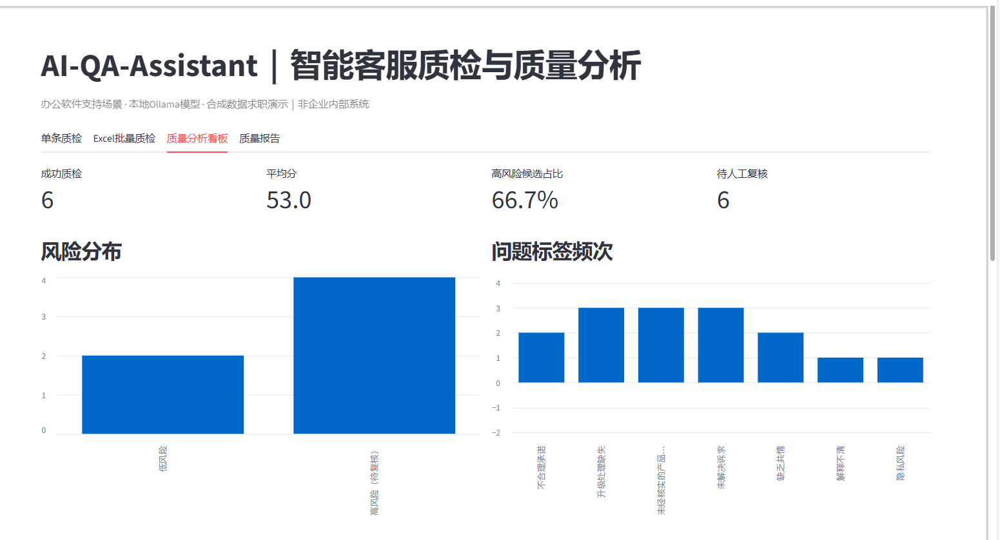
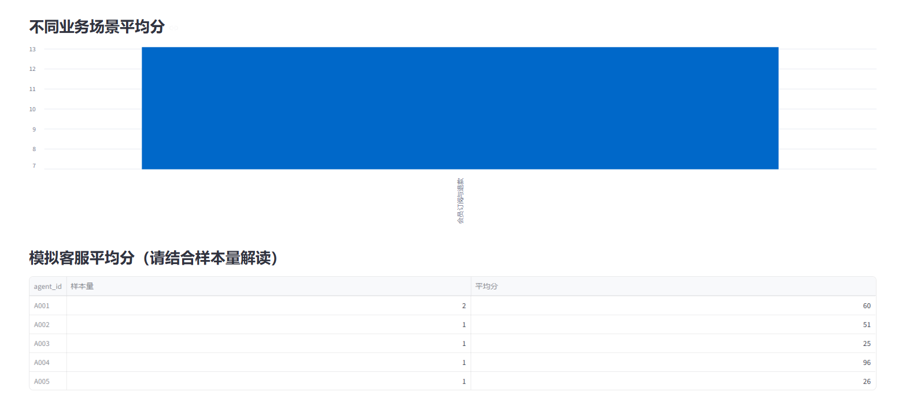
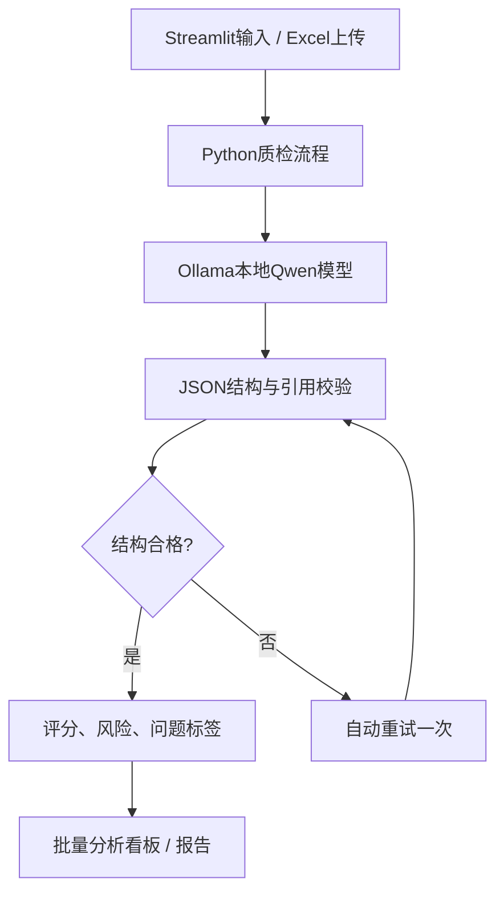

# AI-QA-Assistant

**基于本地大语言模型的客服智能质检与服务质量分析工具**

使用 Python、Streamlit、Ollama 和 Qwen3.5，针对办公软件用户支持的模拟场景，实现对客服对话的结构化评分、风险初判、批量分析和质量报告生成。

> **项目性质：** 个人独立开发的求职演示项目。所有客服对话均为合成案例，不是金山办公或 WPS 的内部数据；评分规范也不是任何公司的官方质检标准。

## 1. 项目背景

传统的客服对话抽检需要人工逐条阅读和记录。这个项目尝试将规则化质检环节交给本地大语言模型辅助完成，再通过原文校验、异常重试、结果导出和人工复核标记，提高分析过程的可检查性。

项目覆盖五类模拟业务场景：会员订阅与退款、云文档同步异常、PDF 编辑与转换、AI 功能使用、账号及协作权限。

## 2. 核心功能

| 模块 | 能力 |
| --- | --- |
| 单条智能质检 | 四维评分（各0–25分）、问题描述、原文证据、改善建议 |
| 风险识别 | 风险分级、严重违规候选标记、人工复核提示 |
| 批量处理 | Excel/CSV 导入、逐条质检、进度显示、结果导出 |
| 质量分析 | 平均分、风险等级分布、高频问题标签、业务场景与客服维度统计 |
| 质量报告 | 从成功记录生成模拟质量概况与改进建议，导出 Markdown |
| 稳定性处理 | JSON结构检查、评分维度完整性校验、原文引用校验；V2.2对结构错误自动重试一次 |

四个评分维度：

1. 用户诉求识别与问题处理
2. 服务态度与沟通
3. 专业准确性与表达
4. 风险与流程合规

综合评分与严重违规候选标志分开管理，避免只根据总分遗漏某些风险情境。模型的判断是**初判**，不能代替真实政策核实与人工定责。

## 3. 运行界面

以下为早期 V2.0 实际运行截图，展示质量分析看板的整体指标、风险分布、问题标签及客服对比功能。V2.1/V2.2 在此基础上优化了评分提示词和异常处理，界面布局基本延续。





> 建议在最终发布前，再补充 `single_qa.png`（单条质检）、`batch_qa.png`（Excel批量进度）、`quality_report.png`（报告）三张实际运行截图，并在本节添加相应图片。不要在公开截图中展示用户真实隐私信息。

## 4. 测试数据与运行结果

构建30条**合成**客服对话：5类模拟场景，每类6条，覆盖预设良好、一般服务问题和明显风险三种情况。这些预设标签用于测试覆盖，不等于独立人工标注的客观真值。

### V2.1本地批量运行记录（2026-10-25）

| 指标 | 实测结果 |
| --- | ---: |
| 输入记录 | 30条 |
| 成功处理 | 29条 |
| 处理成功率 | 96.7% |
| 平均每条处理耗时（含失败任务） | 12.25秒 |
| 高风险候选 | 16/29条成功记录 |
| 检出原文引用异常的记录 | 5条 |

**发现并记录的主要问题：**

- `QA017` 首次测试中模型重复输出评分维度，导致结构检查失败。
- 部分模型输出并非逐字原文引用，校验程序会保留并标记异常。
- 合成样本中的一般服务问题可能被模型判为高风险，需人工判断是否过度预警。

V2.2针对结构化输出错误添加一次自动重试，并通过4项不依赖实际模型服务的自动回归测试；**尚未在这批30条案例上获得独立的新一轮实测成功率**。因此上表保持V2.1原始结果，不将自动测试通过表述为线上效果提升。

目前未建立独立的人工标注评测集，因此不报告“风险识别准确率”“召回率”或真实客服业务提升幅度。

## 5. 技术结构



主要组件：

- **Python / Pandas**：批量数据读取、统计与导出。
- **Streamlit**：本地交互页面、指标及图表展示。
- **Ollama + Qwen3.5:4B**：本地语言模型推理，无需调用付费云端API。
- **openpyxl**：Excel读写。

## 6. 如何在Windows本地运行

要求：已安装 Python，并安装及启动 [Ollama](https://ollama.com/)；本地已经下载与代码设置一致的模型。

在 PowerShell 中进入项目目录：

```powershell
cd E:\AI_Projects\AI-QA-Assistant
```

如果已存在虚拟环境，直接安装依赖：

```powershell
.\.venv\Scripts\python.exe -m pip install -r requirements.txt
```

如果尚未创建虚拟环境：

```powershell
python -m venv .venv
.\.venv\Scripts\python.exe -m pip install -r requirements.txt
```

首次使用模型时：

```powershell
ollama pull qwen3.5:4b
```

启动应用：

```powershell
.\.venv\Scripts\python.exe -m streamlit run app.py
```

浏览器通常打开 `http://localhost:8501`。在侧边栏可修改Ollama模型名。模型运行时间受本地硬件和输入长度影响。

## 7. 如何复现演示

1. **单条质检**：输入一条模拟退款争议对话，查看评分、风险依据和原文证据。
2. **批量质检**：上传 `data/wps_qa_samples.xlsx`，先选择前6条确认流程，再运行30条。
3. **质量看板**：观察风险分布、标签频次和各场景平均分。
4. **质量报告**：导出Markdown格式质量分析报告。
5. **自动测试**：如果包含 `test_v22.py`，在项目根目录执行：

```powershell
.\.venv\Scripts\python.exe test_v22.py
```

> 当前批量结果以网页会话状态保存，建议处理完成后立即下载Excel。暂未开发长期数据库、权限管理、语音转写或线上部署。

## 8. 代码结构

```text
AI-QA-Assistant/
├── app.py                  # V2.2主程序
├── requirements.txt        # Python依赖
├── README.md               # 项目说明
├── test_v22.py             # 结构异常回归测试
├── data/
│   └── wps_qa_samples.xlsx # 合成测试数据
├── rules/
│   └── qa_rules.md         # 模拟评分规则
├── examples/
│   ├── qa_batch_results.xlsx
│   └── qa_quality_report.md
└── screenshots/
    ├── dashboard_overview.png
    └── dashboard_details.png
```

## 9. 已知局限与后续改进

- 小模型偶尔会重复评分维度、改写原文，结构重试与引用检查仍不能完全消除模型错误。
- 风险初判依赖规则提示词，缺少与真实服务规范、最新产品政策的核对。
- 模拟测试集规模小、质量等级人为设计，不能推广为真实客服服务质量指标。
- 尚缺独立人工标注、正式的召回率/精确率等质量评估。
- 后续可加入人工复核结果留存、失败任务续跑、录音转写及政策知识库。

## 10. 数据与隐私声明

该项目仅供学习、技术演示和个人求职展示。公开仓库中只使用合成或充分脱敏的数据；不得上传真实客户账号、密码、验证码、电话或企业内部资料。
